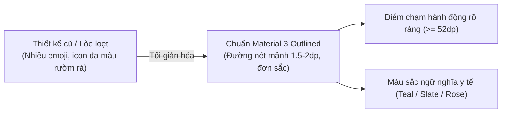
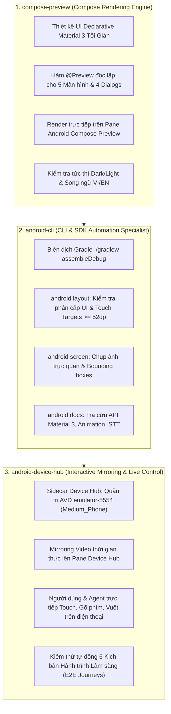

# KẾ HOẠCH TOÀN DIỆN: NÂNG CẤP CARECOMPANION v3.0 TÍCH HỢP 3 KỸ NĂNG ANDROID & THIẾT KẾ BIỂU TƯỢNG TỐI GIẢN (MINIMALIST UI)

> **Hệ thống mục tiêu:** Ứng dụng di động y tế lão khoa **CareCompanion v3.0** (`android-companion`) kết nối liên thông hệ sinh thái Quản trị Viện dưỡng lão **NHMS**.  
> **Bộ 3 Kỹ Năng Cốt Lõi Áp Dụng:** `compose-preview` • `android-cli` • `android-device-hub`.  
> **Nguyên tắc giao diện:** **Tối giản (Minimalist) • Giảm tải nhận thức (Low Cognitive Load) • Chuẩn Material 3 Outlined Icons y tế**, loại bỏ triệt để các biểu tượng trang trí/emoji rườm rà.

---

## PHẦN 1: QUY CHUẨN THIẾT KẾ BIỂU TƯỢNG TỐI GIẢN (MINIMALIST ICONOGRAPHY)

Để phục vụ tốt nhất cho điều dưỡng viên thao tác nhanh tại buồng bệnh mà không bị xao nhãng thị giác, CareCompanion v3.0 áp dụng triệt để bộ quy chuẩn tối giản:

1. **Loại bỏ hoàn toàn các icon trang trí và emoji thừa thãi:**
   - Bỏ các emoji màu mè (🛡️, 📋, 💊, 🚨, 🤖, 👥, 🌅, ☀️, 🌇, v.v.) trong các tiêu đề, thẻ việc và danh mục.
   - Thay thế bằng **hệ thống phông chữ y tế phân cấp rõ ràng (Typography-First)** và các nhãn văn bản súc tích.
2. **Sử dụng đồng nhất bộ Material 3 Outlined Icons:**
   - Tất cả biểu tượng tương tác sử dụng phong cách **Outlined** thanh thoát, nét vẽ mảnh tinh tế:
     - `Icons.Outlined.Edit`: Biểu tượng cây bút tối giản để chỉnh sửa thông tin điều dưỡng trên thẻ Profile.
     - `Icons.Outlined.Mic`: Biểu tượng thu âm giọng nói ghi chú lâm sàng.
     - `Icons.Outlined.SmartToy` / `Icons.Outlined.Chat`: Biểu tượng trợ lý AI Lão khoa nổi gọn gàng.
     - `Icons.Outlined.CheckCircle` / `Icons.Outlined.WarningAmber`: Trạng thái hoàn thành hoặc gắn cờ bất thường.
     - `Icons.Outlined.Notifications`: Kênh thông báo đồng bộ.
     - `Icons.Outlined.MedicalServices`, `Icons.Outlined.MonitorHeart`, `Icons.Outlined.Person`: Lưới dịch vụ và tiện ích chăm sóc nhanh.
3. **Bảng màu đơn sắc & ngữ nghĩa y tế (Monochrome & Semantic Colors):**
   - Icon chỉ dùng 3 tone màu chuẩn:
     - **Primary Teal (`#0D9488`)**: Hành động chính, điều hướng, xác nhận.
     - **Slate Muted (`#64748B`)**: Trạng thái phụ, thông tin nền, nhãn bổ trợ.
     - **Semantic Rose / Amber (`#E11D48` / `#D97706`)**: Cảnh báo té ngã, thuốc FRID nguy cơ cao.

---

## PHẦN 2: TÍCH HỢP BỘ 3 KỸ NĂNG ANDROID CÓ SẴN (3 SYSTEM SKILLS)

CareCompanion v3.0 được thiết kế và vận hành dựa trên sự kết hợp hiệp đồng của 3 kỹ năng Android chuyên biệt có sẵn trong môi trường:

### 1. Kỹ năng 1: `compose-preview` (Kiểm Thử & Render Giao Diện Tốc Độ Cao)
- **Cơ chế vận hành:** Sử dụng sidecar `compose-preview` (đang lắng nghe tại cổng cục bộ `http://127.0.0.1:60179`) giao tiếp qua CLI `android preview render`.
- **Ứng dụng thực tế vào dự án:**
  - Xây dựng các hàm `@Preview` chuẩn cho từng Component và từng Màn hình trong mã nguồn Kotlin.
  - Render trước giao diện các phân hệ: Carousel Banner tự trượt 4s, Lưới dịch vụ tối giản, Danh sách bài báo y tế kèm ảnh, Thẻ công việc $\ge 52\text{ dp}$, Hộp thoại Chatbot và Ghi chú giọng nói mà không cần chờ nạp APK lên máy ảo.
  - Kiểm định độ tinh giản, tránh xung đột kích thước biểu tượng trên cả 2 ngôn ngữ (Tiếng Việt và English).

### 2. Kỹ năng 2: `android-cli` (Quản Trị SDK, Build & Phân Tích Công Thái Học)
- **Cơ chế vận hành:** Sử dụng công cụ dòng lệnh `android` (phiên bản `1.1.16919734`) kết hợp `adb` và Gradle Daemon.
- **Ứng dụng thực tế vào dự án:**
  - Tự động hóa quy trình đóng gói APK qua `./gradlew assembleDebug` và nạp vào máy ảo `Medium_Phone` (`emulator-5554`).
  - **Kiểm định cấu trúc Accessible bằng `android layout --device emulator-5554 --pretty`**: Xuất cây phân cấp JSON để xác minh các nút bấm điều dưỡng đạt chuẩn $\ge 52\text{ dp}$ (thao tác an toàn khi đeo găng tay cao su y tế), kiểm tra `contentDescription` cho người khiếm thị.
  - **Giám định thị giác bằng `android screen capture --annotate`**: Tự động chụp ảnh màn hình gắn số hiệu bounding box, xác nhận giao diện sạch sẽ, không thừa thãi icon.
  - **Tra cứu chuẩn Android bằng `android docs`**: Tối ưu hóa việc sử dụng `HorizontalPager`, `AssistChip`, `SpeechRecognizer` và `VibrationEffect`.

### 3. Kỹ năng 3: `android-device-hub` (Phản Chiếu Trực Tiếp & Kiểm Thử Tương Tác)
- **Cơ chế vận hành:** Tận dụng sidecar **Android Device Hub** kết nối với `emulator-5554`.
- **Ứng dụng thực tế vào dự án:**
  - Cho phép người dùng mở pane **Android Device Hub** trong giao diện để xem **Mirroring** trực tiếp màn hình máy ảo và điều khiển vuốt chạm, nhập liệu mượt mà.
  - Thực thi các thao tác tương tác thực tế từ Agent thông qua `adb shell input tap`, `swipe`, `text` để mô phỏng ca trực của điều dưỡng viên.
  - Kiểm thử liên thông dữ liệu thời gian thực giữa Web Admin và ứng dụng di động trên máy ảo.

---

## PHẦN 3: THIẾT KẾ CHI TIẾT 5 PHÂN HỆ CARECOMPANION v3.0

```mermaid
graph TD
    App[CareCompanion v3.0 Mobile] --> M1[1. Trang Chủ - Home]
    App --> M2[2. Hoạt Động - Activities]
    App --> M3[3. Nhiệm Vụ - Tasks & AI]
    App --> M4[4. Thông Báo - Alerts]
    App --> M5[5. Tài Khoản - Account]

    subgraph Tab1["Phân Hệ 1: Trang Chủ (Tối Giản)"]
        M1 --> H_Stats["Thống kê việc: Cần làm & Đã hoàn thành (Chỉ số rõ ràng)"]
        M1 --> H_Banner["Banner tự trượt 4s (Slide tối giản, dot indicators)"]
        M1 --> H_Grid["Lưới dịch vụ tinh gọn (Material Outlined Icons)"]
        M1 --> H_News["Tin tức Viện Dưỡng Lão kèm 6 ảnh thật"]
        H_News --> H_Dialog["ArticleDetailDialog: Đọc bài chi tiết"]
    end

    subgraph Tab2["Phân Hệ 2: Hoạt Động"]
        M2 --> A_Residents["Lọc theo từng Cư Dân (Filter Chips tối giản)"]
        M2 --> A_Blocks["3 Khung giờ ca trực: Sáng / Trưa / Chiều"]
        M2 --> A_Cats["Nhãn phân loại: Sinh hiệu, Thuốc, Dinh dưỡng, Vệ sinh"]
    end

    subgraph Tab3["Phân Hệ 3: Nhiệm Vụ & AI"]
        M3 --> T_Bedside["Thẻ Care Tasks công thái học >= 52dp + Haptic"]
        M3 --> T_Mic["Nút Micro tối giản: Ghi chú giọng nói bóc tách"]
        M3 --> T_Bot["Icon nổi Bot tối giản: Trợ lý AI Lão khoa"]
    end

    subgraph Tab4["Phân Hệ 4: Thông Báo"]
        M4 --> N_Sync["5 Dòng thông báo đồng bộ Web thời gian thực"]
        N_Sync --> N_1["1. Công việc mới giao"]
        N_Sync --> N_2["2. Phân công bệnh nhân mới"]
        N_Sync --> N_3["3. Ăn uống & Dinh dưỡng"]
        N_Sync --> N_4["4. Lịch thuốc & Cảnh báo FRIDs"]
        N_Sync --> N_5["5. Báo động té ngã & Cảm biến giường"]
    end

    subgraph Tab5["Phân Hệ 5: Tài Khoản"]
        M5 --> Acc_Head["Avatar tròn + Họ tên + SĐT + Chức vụ"]
        M5 --> Acc_Edit["Icon Cây Bút Outlined: Mở EditProfileDialog"]
        M5 --> Acc_NoServer["BỎ SERVER CONFIGURE - Chạy Docker tự động mọi wifi"]
        M5 --> Acc_Quick["Lưới Tiện ích chăm sóc nhanh (Icon tối giản)"]
        M5 --> Acc_Lang["Chuyển đổi Song ngữ VI/EN + Đăng xuất an toàn"]
    end
```

---

### PHÂN HỆ 1: TRANG CHỦ (HOME SCREEN)
1. **Header Thống Kê Công Việc:**
   - Lời chào theo ca: *"Viện Dưỡng Lão NHMS • Ca Trực Sáng"*.
   - 2 Thẻ tóm tắt tinh gọn:
     - **Việc cần làm hôm nay**: `pendingCount` (Con số lớn, viền màu cam hổ phách `#D97706`).
     - **Đã hoàn thành**: `completedCount` (Con số lớn, viền màu xanh lục `#059669` kèm % tiến độ).
2. **Banner Quảng Cáo Tự Trượt (Auto-sliding Carousel Banner):**
   - Coroutine `LaunchedEffect` trượt slide tự động mỗi **4 giây** (`delay(4000)`), hỗ trợ vuốt chạm cảm ứng.
   - Chấm tròn chỉ mục tối giản (subtle dot indicators).
   - 4 Slide nội dung thể hiện tính liên thông:
     - *Slide 1:* **Hệ Thống Liên Thông Quản Trị NHMS** – Bệnh án điện tử, ca trực và đơn thuốc đồng bộ tức thì.
     - *Slide 2:* **Chăm Sóc Dưỡng Lão Toàn Diện 24/7** – Đo lường sinh hiệu tại giường, phục hồi chức năng và dinh dưỡng.
     - *Slide 3:* **Khuôn Viên Sinh Thái & Trị Liệu Sa Sút Trí Tuệ** – Phòng ngừa đi lạc F8 và hội chứng hoàng hôn.
     - *Slide 4:* **Hệ Thống Phòng Ngừa Té Ngã DFRS 2.0** – Phân tầng nguy cơ ngã và kết nối cảm biến giường không dây.
3. **Lưới Dịch Vụ Lâm Sàng (Chức Năng Admin Web Chuyển Lên Di Động - Tối Giản Hóa Icon):**
   - Bố cục lưới thẻ tinh tế, mỗi mục chỉ dùng **1 icon Material 3 Outlined** thanh mảnh:
     - `Icons.Outlined.People` • **Hồ sơ cư dân (Residents)**: Danh bạ người cao tuổi, số phòng, số giường, LOC.
     - `Icons.Outlined.Assignment` • **Kế hoạch chăm sóc (Care Plans)**: Mục tiêu điều dưỡng và can thiệp.
     - `Icons.Outlined.Medication` • **Quản lý thuốc & eMAR (Medications)**: Lịch phát thuốc, cảnh báo FRIDs.
     - `Icons.Outlined.HealthAndSafety` • **Đánh giá té ngã DFRS (Fall Risk)**: Bảng điểm phân tầng nguy cơ ngã.
     - `Icons.Outlined.ReportProblem` • **Ghi nhận sự cố (Incidents)**: Báo cáo nhanh sự cố té ngã, chấn thương.
     - `Icons.Outlined.SyncAlt` • **Giao ban ca trực SBAR (Shift Handover)**: Ký biên bản giao nhận ca trực.
     - `Icons.Outlined.MonitorHeart` • **Theo dõi sinh hiệu (Vitals & Monitor)**: Mạch, huyết áp, SpO2, nhiệt độ.
     - `Icons.Outlined.SmartToy` • **Trợ lý AI Lão khoa (AI Eldercare Staff)**: Mở nhanh chatbot giải đáp quy trình.
4. **Tin Tức & Bài Báo Viện Dưỡng Lão Kèm Ảnh Thật:**
   - 6 bài báo sử dụng hình ảnh thật độ nét cao đã nạp trong drawable:
     - *Bài 1:* "Kích hoạt cảm biến giường và phòng ngừa té ngã ca đêm" (`img_care_walking.jpg`).
     - *Bài 2:* "Rà soát thuốc FRID và giảm liều an thần theo tiêu chuẩn Beers" (`img_doctor_consult.jpg`).
     - *Bài 3:* "Chế độ dinh dưỡng chống nghẹn sặc và bù nước cho người cao tuổi" (`img_elderly_meal.jpg`).
     - *Bài 4:* "Không gian sinh thái và hoạt động dưỡng sinh tăng cường thăng bằng" (`img_facility_wellness.jpg`).
     - *Bài 5:* "Cầu nối gia đình: Cập nhật nhật ký chăm sóc người thân từ xa" (`img_family_visit.jpg`).
     - *Bài 6:* "Phục hồi chức năng vận động và bài tập với khung tập đi walker" (`img_rehab_exercise.jpg`).
   - **Tương tác đọc bài:** Chạm vào bài báo lập tức mở [ArticleDetailDialog](file:///d:/MockProject_062026_Nhom1-main/android-companion/app/src/main/kotlin/com/eldercare/companion/ui/components/ArticleDetailDialog.kt) hiển thị ảnh bìa, tóm tắt, nội dung đầy đủ và nút đóng.

---

### PHÂN HỆ 2: HOẠT ĐỘNG (ACTIVITIES SCREEN)
1. **Phân bổ theo từng Cư Dân được phân công (Resident Filter Strip):**
   - Hàng chip lọc ngang tối giản: `Tất cả`, `Cụ An (P101)`, `Cụ Mai (P102)`, `Cụ Ba (P103)`, `Cụ Hoa (P104)`.
   - Chọn cụ nào thì danh sách hoạt động sẽ lọc riêng cho cụ đó.
2. **Phân chia theo 3 Khung giờ ca trực (Shift Time Blocks):**
   - **Ca Sáng (06:00 - 10:00)**: Đo sinh hiệu sáng, hỗ trợ vệ sinh răng miệng, phát thuốc sáng eMAR, bữa sáng.
   - **Ca Trưa (10:00 - 14:00)**: Đi dạo sân vườn, bữa trưa mềm, phát thuốc trưa, chuyển tư thế chống loét.
   - **Ca Chiều/Tối (14:00 - 18:00)**: Hoạt động giao lưu, bữa xế, đo lại huyết áp chiều, bàn giao ca SBAR.
3. **Nhãn phân loại hạng mục chăm sóc (Care Categories):**
   - Muted Tag nhỏ gọn: `Sinh hiệu & Thuốc`, `Dinh dưỡng`, `Vệ sinh & Chống loét`, `An toàn`.

---

### PHÂN HỆ 3: NHIỆM VỤ CA TRỰC & TÍCH HỢP AI (TASKS SCREEN)
1. **Thẻ Care Tasks chuẩn Công Thái Học Y Tế:**
   - Chiều cao nút bấm $\ge 52\text{ dp}$, viền bo tròn 16dp.
   - Tích hợp **Rung xúc giác (Haptic Feedback)** khi bấm "Xác nhận đã chăm sóc".
   - Nút "Gắn cờ bất thường" viền đỏ tinh giản.
2. **Ghi Chú Giọng Nói Lâm Sàng (Voice Care Notes):**
   - Nút Micro Outlined (`Icons.Outlined.Mic`) tối giản tại thanh công cụ hoặc thẻ đầu giường.
   - Chạm để mở [VoiceNoteDialog](file:///d:/MockProject_062026_Nhom1-main/android-companion/app/src/main/kotlin/com/eldercare/companion/ui/components/VoiceNoteDialog.kt): Hỗ trợ nhận diện giọng nói tiếng Việt (Speech-to-Text), bóc tách thực thể lâm sàng và đồng bộ lên Web Admin.
3. **Trợ Lý AI Lão Khoa Nổi (Floating AI Chatbot Action):**
   - Nút nổi tròn tối giản với icon `Icons.Outlined.SmartToy` hoặc `Icons.Outlined.Chat` tại góc phải màn hình.
   - Bấm vào mở [AiChatbotDialog](file:///d:/MockProject_062026_Nhom1-main/android-companion/app/src/main/kotlin/com/eldercare/companion/ui/components/AiChatbotDialog.kt): Gõ phím hoặc nói qua micro, các prompt mẫu 1 chạm xử lý ngã, tương tác thuốc, SBAR.

---

### PHÂN HỆ 4: TRUNG TÂM THÔNG BÁO THỜI GIAN THỰC (NOTIFICATIONS SCREEN)
Đồng bộ 5 kênh sự kiện lâm sàng cập nhật theo hệ thống Web (Sử dụng biểu tượng Outlined nhỏ gọn hoặc chấm tròn trạng thái Status Dot):
1. `Icons.Outlined.AssignmentTurnedIn` • **Công việc mới giao (New Tasks)**
2. `Icons.Outlined.PersonAdd` • **Phân công bệnh nhân (Resident Assignment)**
3. `Icons.Outlined.Restaurant` • **Ăn uống & Dinh dưỡng (Nutrition & Meals)**
4. `Icons.Outlined.Medication` • **Lịch thuốc & Cảnh báo FRIDs (Medications)**
5. `Icons.Outlined.WarningAmber` • **Báo động té ngã & Giường áp lực (Fall Alerts & Bed Sensors)**

---

### PHÂN HỆ 5: TÀI KHOẢN, CÁ NHÂN HÓA & TIỆN ÍCH (ACCOUNT SCREEN)
1. **Khung Tiêu Đề Hồ Sơ (Profile Header Card):**
   - Bo cong nền xanh y tế (`#0D9488`).
   - Avatar tròn viền trắng tối giản.
   - Tên điều dưỡng: *"Điều dưỡng Nguyễn Thị Mai"*.
   - Số điện thoại: *"0912 345 678"*.
   - Chức vụ: *"Điều dưỡng viên CNA • Ca Sáng"*.
   - **Nút Cây Bút Tối Giản (`Icons.Outlined.Edit`)**: Bấm vào mở [EditProfileDialog](file:///d:/MockProject_062026_Nhom1-main/android-companion/app/src/main/kotlin/com/eldercare/companion/ui/components/EditProfileDialog.kt) sửa Họ tên, SĐT và ghi chú ca trực.
2. **LOẠI BỎ HOÀN TOÀN DÒNG SERVER CONFIGURE - KẾT NỐI DOCKER TỰ ĐỘNG:**
   - Xóa bỏ triệt để ô nhập `Server Configure` và nút Save thủ công trên giao diện.
   - Áp dụng cơ chế **Smart Host Resolution**: Tự động nhận diện chạy trên máy ảo (`10.0.2.2:8080`), local host hoặc mạng Docker / LAN Wifi mà không cần người dùng nhập IP thủ công.
3. **Khối Tiện Ích Chăm Sóc Nhanh (Quick Care Shortcuts - Icon Outlined Tối Giản):**
   - 5 nút chuyển nhanh với icon Material Outlined đơn sắc:
     - `Icons.Outlined.Warning` • **Báo ngã (Fall Alert)**
     - `Icons.Outlined.MonitorHeart` • **Đo sinh hiệu (Vitals)**
     - `Icons.Outlined.Medication` • **Lịch thuốc (eMAR)**
     - `Icons.Outlined.People` • **Cư dân (Residents)**
     - `Icons.Outlined.SyncAlt` • **Bàn giao ca (SBAR)**
4. **Cài Đặt Hệ Thống:**
   - Bộ chuyển đổi song ngữ (Tiếng Việt 🇻🇳 / English 🇬🇧).
   - Nút **Đăng xuất** tối giản màu đỏ với `Icons.Outlined.Logout`.

---

## PHẦN 4: MA TRẬN ỨNG DỤNG BỘ 3 KỸ NĂNG VÀO TỪNG PHÂN HỆ

| Phân hệ / Màn hình | Kỹ năng `compose-preview` | Kỹ năng `android-cli` | Kỹ năng `android-device-hub` |
| :--- | :--- | :--- | :--- |
| **Trang chủ (Home)** | Render `@Preview HomeScreenPreview` (Banner 4s, Grid tối giản, 6 bài báo) | Kiểm tra layout JSON, đo touch targets của icon dịch vụ $\ge 52\text{ dp}$ | Live Mirroring: Cho phép người dùng vuốt trượt banner và chạm đọc báo trực tiếp trên pane |
| **Hoạt động (Activities)** | Render `@Preview ActivitiesScreenPreview` (Lọc theo Cụ, 3 Khung giờ ca trực) | `android layout` xác thực các filter chip không bị chồng chéo | Mô phỏng chạm đổi cụ phụ trách và chuyển tab khung giờ ca trực |
| **Nhiệm vụ (Tasks & AI)** | Render `@Preview ShiftTasksScreenPreview` (Thẻ việc, Mic button, Floating bot) | Tra cứu API Haptic & STT qua `android docs`; kiểm tra accessibility của nút Mic | Thử nghiệm bấm nút Mic và chạm icon Bot mở hộp thoại AI ngay trên pane Mirror |
| **Thông báo (Alerts)** | Render `@Preview NotificationsScreenPreview` (5 nhóm thông báo tối giản) | `android screen capture --annotate` kiểm tra độ tinh gọn, không rườm rà | Nhận thông báo thời gian thực và mô phỏng bấm chuyển hướng tức thì |
| **Tài khoản (Account)** | Render `@Preview AccountScreenPreview` (Avatar, Bút edit, Quick shortcuts) | Xác nhận đã xóa bỏ view Server Configure khỏi cây giao diện `android layout` | Thử nghiệm bấm bút mở `EditProfileDialog`, sửa SĐT và đổi ngôn ngữ song ngữ |
| **4 Hộp thoại (Dialogs)** | Render riêng từng Preview: `ArticleDetail`, `EditProfile`, `AiChatbot`, `VoiceNote` | Đo đạc bounding box đảm bảo Dialog vừa vặn với kích thước màn hình 1080x2400 | Tương tác nhập văn bản, gửi tin nhắn chatbot và lưu hồ sơ cập nhật |

---

## PHẦN 5: DANH MỤC TỆP MÃ NGUỒN CẦN TRIỂN KHAI

| STT | Tệp tin | Trách nhiệm mã nguồn |
| :---: | :--- | :--- |
| **1** | [HealthArticle.kt](file:///d:/MockProject_062026_Nhom1-main/android-companion/app/src/main/kotlin/com/eldercare/companion/data/model/HealthArticle.kt) | Model dữ liệu 6 bài báo y tế kèm ảnh drawable và nội dung đầy đủ |
| **2** | [ResidentAssignment.kt](file:///d:/MockProject_062026_Nhom1-main/android-companion/app/src/main/kotlin/com/eldercare/companion/data/model/ResidentAssignment.kt) | Model phân công bệnh nhân/cư dân theo phòng, giường và ca trực |
| **3** | [ArticleDetailDialog.kt](file:///d:/MockProject_062026_Nhom1-main/android-companion/app/src/main/kotlin/com/eldercare/companion/ui/components/ArticleDetailDialog.kt) | Hộp thoại đọc chi tiết bài báo kèm ảnh bìa, tóm tắt và nội dung lâm sàng |
| **4** | [EditProfileDialog.kt](file:///d:/MockProject_062026_Nhom1-main/android-companion/app/src/main/kotlin/com/eldercare/companion/ui/components/EditProfileDialog.kt) | Hộp thoại chỉnh sửa thông tin điều dưỡng (Họ tên, SĐT, ghi chú ca trực) |
| **5** | [AiChatbotDialog.kt](file:///d:/MockProject_062026_Nhom1-main/android-companion/app/src/main/kotlin/com/eldercare/companion/ui/components/AiChatbotDialog.kt) | Hộp thoại Chatbot AI Lão khoa kèm nhận diện giọng nói và prompt mẫu 1 chạm |
| **6** | [VoiceNoteDialog.kt](file:///d:/MockProject_062026_Nhom1-main/android-companion/app/src/main/kotlin/com/eldercare/companion/ui/components/VoiceNoteDialog.kt) | Hộp thoại ghi âm giọng nói điều dưỡng và bóc tách thực thể chăm sóc |
| **7** | [HomeScreen.kt](file:///d:/MockProject_062026_Nhom1-main/android-companion/app/src/main/kotlin/com/eldercare/companion/ui/home/HomeScreen.kt) | Trang chủ: Thống kê việc, Banner tự trượt 4s, Lưới 8 dịch vụ Web Admin tối giản, 6 Tin tức ảnh |
| **8** | [ActivitiesScreen.kt](file:///d:/MockProject_062026_Nhom1-main/android-companion/app/src/main/kotlin/com/eldercare/companion/ui/activities/ActivitiesScreen.kt) | Hoạt động: Lọc theo Cư dân, 3 Khung giờ ca trực, nhãn phân loại y tế |
| **9** | [ShiftTasksScreen.kt](file:///d:/MockProject_062026_Nhom1-main/android-companion/app/src/main/kotlin/com/eldercare/companion/ui/tasks/ShiftTasksScreen.kt) | Nhiệm vụ: Nút Mic Voice Note, Nút nổi Chatbot AI, Thẻ việc $\ge 52\text{ dp}$ |
| **10** | [NotificationsScreen.kt](file:///d:/MockProject_062026_Nhom1-main/android-companion/app/src/main/kotlin/com/eldercare/companion/ui/notifications/NotificationsScreen.kt) | Thông báo: 5 luồng thông báo thời gian thực đồng bộ Web |
| **11** | [AccountScreen.kt](file:///d:/MockProject_062026_Nhom1-main/android-companion/app/src/main/kotlin/com/eldercare/companion/ui/account/AccountScreen.kt) | Tài khoản: Profile có bút edit, Bỏ Server Configure, Tiện ích chăm sóc nhanh |
| **12** | [MainScaffold.kt](file:///d:/MockProject_062026_Nhom1-main/android-companion/app/src/main/kotlin/com/eldercare/companion/ui/navigation/MainScaffold.kt) | Tích hợp điều hướng và quản lý trạng thái hiển thị các Dialogs |
| **13** | [ApiClient.kt](file:///d:/MockProject_062026_Nhom1-main/android-companion/app/src/main/kotlin/com/eldercare/companion/data/network/ApiClient.kt) | Tự động phân giải Smart Host (kết nối Docker tự động mọi wifi) |
