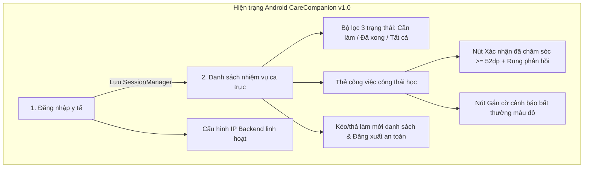
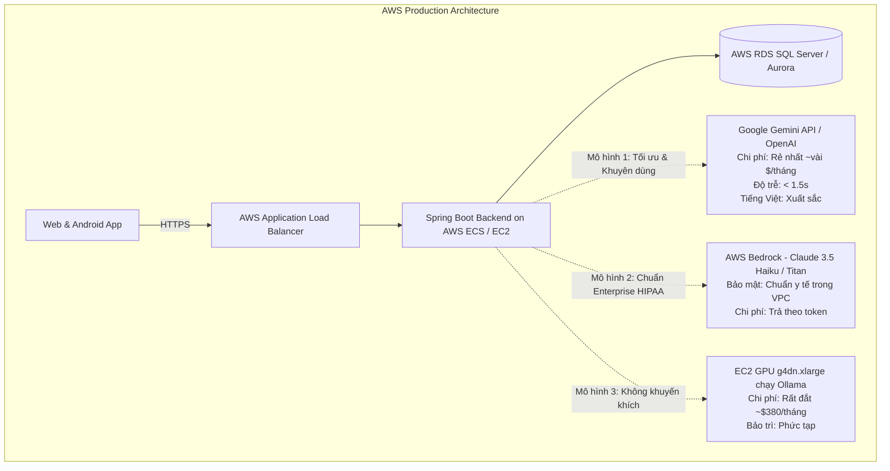

# Kế Hoạch Hoàn Chỉnh: Nâng Cấp Hệ Thống NHMS & Tái Cấu Trúc Toàn Diện Ứng Dụng Di Động CareCompanion

> **Phiên bản tài liệu:** 2.0 (Toàn diện)  
> **Phạm vi:** Web Admin Portal (React + Spring Boot), Cơ sở dữ liệu, Kiến trúc Điện toán Đám mây AWS và Ứng dụng Di động Android (Jetpack Compose).  
> **Mục tiêu:** Giải quyết dứt điểm các lỗi logic dữ liệu trên Web, minh bạch hóa cơ chế AI vs. Heuristic, định hình giải pháp Cloud AWS cho LLM và tái cấu trúc CareCompanion thành ứng dụng di động 5 tab chuẩn công thái học điều dưỡng.

---

## MỤC LỤC
1. [Báo Cáo Tính Năng Ứng Dụng Android CareCompanion Hiện Có](#phần-1-báo-cáo-tính-năng-ứng-dụng-android-carecompanion-hiện-có)
2. [Truy Vết Nguyên Nhân Gốc Rễ (Root Cause) Các Lỗi Trên Web & Backend](#phần-2-truy-vết-nguyên-nhân-gốc-rễ-root-cause-các-lỗi-trên-web--backend)
3. [Kiểm Toán Toàn Diện AI: Phân Biệt AI Thật vs. Thuật Toán Quy Tắc (CDSS Heuristic)](#phần-3-kiểm-toán-toàn-diện-ai-phân-biệt-ai-thật-vs-thuật-toán-quy-tắc-cdss-heuristic)
4. [Kiến Trúc Triển Khai AWS & Giải Đáp Khả Năng Vận Hành LLM Trên Cloud](#phần-4-kiến-trúc-triển-khai-aws--giải-đáp-khả-năng-vận-hành-llm-trên-cloud)
5. [Tái Cấu Trúc Giao Diện Di Động CareCompanion (Chuẩn 5 Phân Hệ)](#phần-5-tái-cấu-trúc-giao-diện-di-động-carecompanion-chuẩn-5-phân-hệ)
6. [Lộ Trình Triển Khai Master Plan (Action Items Chi Tiết)](#phần-6-lộ-trình-triển-khai-master-plan-action-items-chi-tiết)

---

## PHẦN 1: BÁO CÁO TÍNH NĂNG ỨNG DỤNG ANDROID CARECOMPANION HIỆN CÓ

Ứng dụng di động [android-companion](android-companion) đã được khởi tạo hoàn chỉnh bằng Kotlin 2.0 + Jetpack Compose, đã biên dịch thành công file APK [app-debug.apk](android-companion/app/build/outputs/apk/debug/app-debug.apk) (dung lượng 19.6 MB), vượt qua 100% Unit Tests và đã chạy kiểm thử trực tiếp trên máy ảo Android `Medium_Phone` (`emulator-5554`).



### Các module kỹ thuật đã hoạt động:
1. **Quản lý phiên & Cấu hình mạng ([SessionManager.kt](android-companion/app/src/main/kotlin/com/eldercare/companion/data/SessionManager.kt))**:
   - Lưu trữ an toàn: token phiên, mã CNA ID, họ tên điều dưỡng, vai trò.
   - Hỗ trợ đổi `Base URL` linh hoạt (`10.0.2.2:8080` cho máy ảo hoặc IP mạng LAN `192.168.x.x:8080` cho điện thoại thật).
2. **Tầng giao tiếp REST ([ApiService.kt](android-companion/app/src/main/kotlin/com/eldercare/companion/data/network/ApiService.kt))**:
   - `POST /api/v1/auth/login`: Xác thực và nhận phiên.
   - `GET /api/v1/auth/me`: Đồng bộ thông tin cá nhân nhân viên.
   - `GET /api/v1/tasks/by-cna`: Lấy danh sách nhiệm vụ chăm sóc phân theo ca trực.
   - `PATCH /api/v1/tasks/{taskId}/completed`: Xác nhận chăm sóc hoàn tất tại giường.
   - `PATCH /api/v1/tasks/{taskId}/flag-abnormal`: Ghi nhận cờ bất thường về sức khỏe người bệnh.
3. **Màn hình Đăng nhập lâm sàng ([LoginScreen.kt](android-companion/app/src/main/kotlin/com/eldercare/companion/ui/auth/LoginScreen.kt))**:
   - Giao diện Material 3, tự động co giãn cuộn bàn phím ảo (`imePadding`), bắt ngoại lệ mạng an toàn và hiển thị thông báo lỗi rõ ràng.
4. **Màn hình Ca trực & Thẻ công việc ([ShiftTasksScreen.kt](android-companion/app/src/main/kotlin/com/eldercare/companion/ui/tasks/ShiftTasksScreen.kt), [TaskCard.kt](android-companion/app/src/main/kotlin/com/eldercare/companion/ui/components/TaskCard.kt))**:
   - Thiết kế chuẩn công thái học điều dưỡng (*One-handed Thumb Zone*).
   - Nút bấm lớn $\ge 52\text{ dp}$ thao tác dễ dàng khi đeo găng tay y tế.
   - Phản hồi xúc giác rung (*Haptic Feedback*) khi hoàn thành nhiệm vụ.
   - Cập nhật giao diện lạc quan (*Optimistic UI update*) tức thì.

---

## PHẦN 2: TRUY VẾT NGUYÊN NHÂN GỐC RỄ (ROOT CAUSE) CÁC LỖI TRÊN WEB & BACKEND

### 1. Tại sao toàn bộ cư dân đều hiển thị: *"🛡️ [CNA] Duy trì chiếu sáng đèn ngủ ban đêm và dọn sạch chướng ngại vật trên sàn phòng"*? Có áp dụng AI chưa?
- **Nguyên nhân mã nguồn**:
  Nằm tại tệp [DynamicFallRiskService.java (dòng 536–543)](backend/src/main/java/com/eldercare/modules/ai/risk/service/DynamicFallRiskService.java#L536-L543):
  ```java
  } else {
      list.add(DynamicFallRiskDto.FallInterventionDto.builder()
              .role("CNA")
              .priority("ROUTINE")
              .action("Duy trì chiếu sáng đèn ngủ ban đêm và dọn sạch chướng ngại vật trên sàn phòng")
              .rationale("Duy trì an toàn sinh hoạt thường quy")
              .build());
  }
  ```
  Hàm `evaluateDfrs()` tính điểm tổng DFRS từ 4 tiêu chuẩn: Lịch sử ngã 90 ngày (`incidentScore`), Thuốc tăng nguy cơ ngã (`medicationScore`), Khả năng vận động (`adlScore`), và Dấu hiệu sinh tồn (`vitalScore`).
  - Do cơ sở dữ liệu hiện tại chưa có dữ liệu sự cố ngã trong 90 ngày (`incidentScore = 0`), chưa liên kết đơn thuốc (`medicationScore = 0`), và chưa có đánh giá Morse (`morseOpt.isEmpty()`), nên mọi cư dân đều chỉ nhận điểm mặc định **5/100**.
  - Mức điểm $5 < 30$ bị xếp vào hạng **`LOW RISK`**.
  - Nhánh `LOW RISK` trong code chỉ có **duy nhất 1 hành động mặc định cố định** là chuỗi chữ trên.
- **Có áp dụng AI vào chưa?**:
  > [!WARNING]
  > **CHƯA HỀ CÓ AI/LLM NÀO Ở ĐÂY**. Đây hoàn toàn là logic rẽ nhánh quy tắc cứng (`if-else` heuristic) viết bằng Java trên backend.

---

### 2. "Active Chart Prescriptions & Fall-Risk Increasing Drugs (FRIDs) bệnh nhân nào có, tôi không thấy bất cứ bệnh nhân nào được cấp thuốc cả, không hiển thị trên web"
- **Nguyên nhân gốc rễ nghiêm trọng trong mã nguồn**:
  - Frontend [ai-service.ts (dòng 27)](frontend/src/features/admin/ai/services/ai-service.ts#L27) gọi endpoint:
    `GET /api/v1/ai/resident-chart-context/{residentId}`
  - Trong backend, phương thức lấy thuốc và phân tích FRID `dynamicFallRiskService.getResidentChartContext(residentId)` **đã được viết xong tại dòng 549**, **NHƯNG lập trình viên backend đã QUÊN khai báo endpoint này trong [AiController.java](backend/src/main/java/com/eldercare/modules/ai/controller/AiController.java)**!
  - Khi frontend gọi API này, backend Spring Boot trả về **HTTP 404 Not Found**.
  - Hàm `loadChartContext` tại [ai-resident-review.tsx (dòng 43)](frontend/src/features/admin/ai/components/ai-resident-review.tsx#L43) và [ai-fall-screening.tsx (dòng 49)](frontend/src/features/admin/ai/components/ai-fall-screening.tsx#L49) bắt lỗi nhưng nuốt lỗi (`catch { // Fallback }`), dẫn đến `chartContext` luôn bằng `null`.
  - Kết quả: Danh sách thuốc `activeMedications` luôn rỗng (0 Orders), không có bất kỳ đơn thuốc nào hiển thị lên giao diện web!

---

### 3. "Recommended Interventions (Assign to Shift): Dựa vào đâu mà tất cả bệnh nhân đều như thế, áp dụng AI tại đâu, gán cho shift là gán cho ai?"
- **Dựa vào đâu**: Dựa vào nhánh `else` của hàm `generateInterventions` khi điểm DFRS $< 30$ như đã phân tích ở mục 1.
- **Áp dụng AI tại đâu**: Không có AI; là template mẫu được hardcode sẵn trong Java DTO.
- **Gán cho shift là gán cho ai?**:
  Xem mã nguồn tại [DynamicFallRiskService.java (dòng 440–477)](backend/src/main/java/com/eldercare/modules/ai/risk/service/DynamicFallRiskService.java#L440-L477):
  ```java
  CareTaskEntity task = CareTaskEntity.builder()
          .careInterventionId(intervention.getId())
          .assignedCnaId(null) // <-- CHƯA GÁN CHO BẤT KỲ AI!
          .taskStatus("PENDING")
          .scheduledTime(scheduledTime)
          .build();
  ```
  Hành động này chỉ tạo ra một đầu việc ở trạng thái **chưa phân công (`assignedCnaId = null`)** gắn với vai trò `CNA`. Nghĩa là công việc này treo ở ca trực chung, cần Điều dưỡng trưởng vào phân bổ cụ thể cho một nhân viên CNA.

---

### 4. "Phần optional: Staff manual là gì, sao trong các lựa chọn lại chỉ toàn yes và no?"
- **Staff Manual Morse Assessment là gì?**:
  Đây là **Thang đo nguy cơ té ngã Morse (Morse Fall Scale - MFS)** – một thang đo đánh giá lâm sàng quốc tế (ban hành năm 1989) gồm 6 tiêu chuẩn do nhân viên y tế tự quan sát và chấm điểm:
  1. Tiền sử té ngã (History of falling): Có / Không
  2. Đa chẩn đoán bệnh lý phụ (Secondary diagnosis): Có / Không
  3. Dụng cụ hỗ trợ di chuyển (Ambulatory aid): Không dùng / Gậy, khung tập đi / Tựa vào bàn ghế
  4. Đang truyền dịch/khóa Heparin (IV therapy): Có / Không
  5. Dáng đi (Gait): Bình thường / Yếu / Rối loạn nặng
  6. Tình trạng tâm thần (Mental status): Tự nhận thức được / Quên giới hạn bản thân
- **Tại sao chỉ toàn Yes và No?**:
  Các tiêu chí 1, 2, 4 trên chuẩn lâm sàng quốc tế bản chất là biến nhị phân (*Có / Không*). Tuy nhiên, trên giao diện [ai-fall-screening.tsx (dòng 13–18)](frontend/src/features/admin/ai/components/ai-fall-screening.tsx#L13-L18), lập trình viên giữ nguyên tiếng Anh `"Yes"`/`"No"`, không dịch giải nghĩa tiếng Việt lâm sàng rõ ràng, tạo cảm giác như một biểu mẫu sơ sài.

---

### 5. "F8 có F8 · Wandering & Elopement Observation Review thì phần luôn hiện Loading chart behavioral history… Ở bên Care Plan cũng thế, mấy phần này áp dụng AI tại đâu và có tác dụng gì không, có thật sự cần thiết không?"
- **Tại sao luôn hiện `Loading chart behavioral history…`?**:
  Chính vì endpoint `/api/v1/ai/resident-chart-context/{residentId}` bị **HTTP 404** (như phát hiện ở mục 2). Biến `loadingChart` hoặc lỗi gọi API không giải phóng dữ liệu, khiến khối giao diện [ai-resident-review.tsx (dòng 204)](frontend/src/features/admin/ai/components/ai-resident-review.tsx#L204) bị nghẽn hiển thị.
- **Mấy phần này áp dụng AI tại đâu và có thật sự cần thiết không?**:
  - **F8 (Wandering / Đi lạc)**: Gọi API `/api/v1/ai/elopement/evaluate` qua `ElopementRiskAiService.java`. Tính năng này dùng LLM đánh giá nguy cơ cụ già mắc sa sút trí tuệ (Alzheimer) tự ý mở cửa ra ngoài gây nguy hiểm tính mạng. *Tính năng này rất cần thiết cho khu chăm sóc trí nhớ (Memory Care)*.
  - **Care Plan AI Assistant**: Gọi `/api/v1/ai/careplan/suggest` qua `CarePlanAiService.java` để sinh mục tiêu chăm sóc cá nhân hóa theo tình trạng sức khỏe.

---

### 6. "Cái care task shift handover và Clinical Shift Handover (SBAR Protocol) khác gì nhau, có chức năng gì, sửa lại cho rõ ràng hơn"
- **Nguyên nhân gây rối**:
  Hiện tại trong code có sự **trùng lặp và phân mảnh**:
  1. Menu chính có: `/admin/shift-handover` gọi trang [shift-handover-page.tsx](frontend/src/features/admin/ai/pages/shift-handover-page.tsx).
  2. Trang Quản lý Care Tasks `/admin/care-tasks` cũng có một tab tên là `"shift-handover"`.
  3. Cả 2 nơi này đều nhúng chung component `<AiShiftSummaryPanel />`.
  4. Nhưng tại [care-task-page.tsx (dòng 38)](frontend/src/features/admin/care-tasks/pages/care-task-page.tsx#L38), có dòng code:
     `&& (t.value !== "shift-handover" || clinicalReviewer)`
     Nếu tài khoản đăng nhập không đủ vai trò trong danh sách `["NURSE", "DON", "ADMIN", "System_Administrator", "NHA_ADMIN"]`, tab này **bị ẩn đi**. Khi người dùng bấm vào link chứa `?tab=shift-handover`, trang tự động nhảy ngược về tab đầu tiên (Care Tasks thông thường), làm người dùng tưởng là tính năng bị lỗi không hiển thị gì!
- **Chức năng chuẩn**:
  - `Care Tasks`: Bảng phân công công việc hàng ngày của từng nhân viên (cho ăn, tắm rửa, đo huyết áp).
  - `Clinical Shift Handover (SBAR)`: Báo cáo giao ban chuyên môn giữa ca trước và ca sau theo chuẩn y khoa SBAR (*Tình huống - Bối cảnh - Đánh giá - Kiến nghị*).

---

## PHẦN 3: KIỂM TOÁN TOÀN DIỆN AI: PHÂN BIỆT AI THẬT VS. THUẬT TOÁN QUY TẮC (CDSS HEURISTIC)

Trong hệ thống NHMS hiện tại, từ ngữ "AI" đang bị dùng lẫn lộn giữa **Trí tuệ nhân tạo tạo sinh (Generative AI / LLM)** và **Hệ thống hỗ trợ ra quyết định lâm sàng dựa trên luật (Clinical Decision Support Systems - CDSS Heuristics)**.

Bảng kiểm toán mã nguồn chi tiết dưới đây phân định rạch ròi 100% bản chất của từng tính năng:

| STT | Phân hệ / Tên Service | Bản chất kỹ thuật | Có dùng LLM không? | Mô tả luồng xử lý thực tế trong mã nguồn |
| :--- | :--- | :---: | :---: | :--- |
| **1** | **Dynamic Fall Risk Service (DFRS 2.0)**<br>`DynamicFallRiskService.java` | **Thuật toán quy tắc (Rule-based CDSS)** | ❌ **KHÔNG** | Tính điểm toán học thuần túy: $35\text{ điểm ngã} + 30\text{ điểm thuốc} + 25\text{ điểm ADL} + 10\text{ điểm sinh hiệu}$. Không có bất kỳ model AI/LLM nào tham gia. |
| **2** | **Staff Manual Morse Assessment**<br>`FallScreeningService.java` | **Thang đo lâm sàng (Clinical Scale)** | ❌ **KHÔNG** | Thang điểm Morse Fall Scale (1989): Cộng điểm cố định 6 câu hỏi từ 0 đến 125 điểm. Hoàn toàn là phép cộng số học. |
| **3** | **Tra cứu an toàn thuốc & Tương tác FRID**<br>`MedicationSafetyAiService.java` | **Hệ chuyên gia đối soát dữ liệu (Catalog Lookup)** | ❌ **KHÔNG** | Đối chiếu danh mục hoạt chất với Tiêu chuẩn AGS Beers 2023, STOPP/START v3 và thang điểm kháng Cholinergic (ACB). Bản chất là tra cứu SQL/Dictionary, không phải AI. |
| **4** | **Phân loại mức độ sự cố y khoa**<br>`IncidentAiService.java` | **Generative AI (LLM)** | ✅ **CÓ** | Sử dụng Ollama (`qwen3.5:2b-q4_K_M`) hoặc Google Gemini để đọc mô tả tai nạn, trích xuất nguyên nhân gốc rễ và phân loại mức độ nghiêm trọng (Insignificant $\rightarrow$ Catastrophic). |
| **5** | **Đánh giá nguy cơ đi lạc F8**<br>`ElopementRiskAiService.java` | **Generative AI (LLM)** | ✅ **CÓ** | Đưa tiền sử bệnh Alzheimer, hành vi đi lang thang vào Prompt của LLM để dự báo xác suất mở cửa ra ngoài trái phép. |
| **6** | **Gợi ý Kế hoạch Chăm sóc (Care Plan)**<br>`CarePlanAiService.java` | **Generative AI (LLM)** | ✅ **CÓ** | Tổng hợp bệnh lý nền, dị ứng, chỉ định của bác sĩ để LLM sinh danh sách mục tiêu điều trị và hành động điều dưỡng. |
| **7** | **Báo cáo Giao ban Ca trực SBAR**<br>`ShiftSummaryDraftService.java` | **Generative AI (LLM)** | ✅ **CÓ** | Đọc toàn bộ sự cố, thuốc bất thường và việc chưa hoàn thành trong ca trực, đưa vào LLM để tóm tắt thành văn bản y khoa chuẩn SBAR. |
| **8** | **Bóc tách ghi chú giọng nói (Voice Note)**<br>`VoiceCareAiService.java` | **Generative AI (LLM)** | ✅ **CÓ** | Nhận chuỗi văn bản do nhân viên nói, dùng LLM để bóc tách thực thể (Entity Extraction): ai, làm gì, cho ai, lúc mấy giờ, có bất thường gì không. |
| **9** | **Trợ lý nhân viên & Hỏi đáp tài liệu y tế**<br>`AiChatService.java` | **Generative AI + RAG** | ✅ **CÓ** | Chatbot nội bộ sử dụng Retrieval-Augmented Generation để tra cứu quy trình điều dưỡng cơ sở. |

### Tại sao trước đây người dùng thấy các tính năng AI hoạt động chập chờn hoặc xuất hiện tiếng Anh lạ?
Trong mã nguồn Spring Boot, ở tất cả các Service có `✅ CÓ (LLM)`, lập trình viên đều bọc khối gọi LLM trong `try-catch`. Khi máy tính dev không bật Ollama, hoặc Ollama bị nghẽn (timeout > 30s), code sẽ rơi vào khối `catch` và trả về **bản ghi mẫu tĩnh (hardcoded fallback mock data bằng tiếng Anh)** như `createFallbackCarePlan()` hoặc `ElderCare-Workflow-Fallback`.

---

## PHẦN 4: KIẾN TRÚC TRIỂN KHAI AWS & GIẢI ĐÁP KHẢ NĂNG VẬN HÀNH LLM TRÊN CLOUD

### Câu hỏi trọng tâm: "Khi đẩy code lên AWS thì LLM còn áp dụng được không?"
> [!IMPORTANT]
> **CÂU TRẢ LỜI LÀ: HOÀN TOÀN ÁP DỤNG ĐƯỢC, VÀ HỆ THỐNG SẼ CHẠY NHANH HƠN, ỔN ĐỊNH HƠN GẤP NHIỀU LẦN SO VỚI CHẠY TRÊN MÁY TÍNH CÁ NHÂN!**

Khi triển khai lên đám mây AWS, kiến trúc LLM không còn bị giới hạn bởi RAM/VRAM của máy tính cá nhân. Có 3 mô hình triển khai LLM trên AWS với ưu/nhược điểm và chi phí rõ ràng:



### 1. Phân tích so sánh 3 mô hình triển khai LLM trên AWS:

#### Mô hình 1: Cloud API thông qua Google Gemini (Mô hình Tối ưu Khuyên dùng)
- **Cách thức hoạt động**:
  - Mã nguồn Backend Spring Boot của NHMS đã tích hợp sẵn cơ chế gọi Google Gemini API qua `AiClientFactory.java` và thư viện Spring AI.
  - Khi triển khai Backend lên AWS (EC2 hoặc AWS ECS Docker), máy chủ AWS chỉ cần cấu hình kết nối Internet ra ngoài (Outbound HTTPS cổng 443).
  - Khi có yêu cầu tóm tắt SBAR, phân tích ngã F8, hoặc gợi ý Care Plan, Backend gửi payload JSON sang Google Cloud Vertex/Gemini API bằng khóa bí mật `GEMINI_API_KEY`.
- **Ưu điểm vượt trội**:
  - **Chi phí cực thấp**: Máy chủ AWS chỉ cần cấu hình loại nhỏ (ví dụ `t3.small` hoặc `t3.medium`, chi phí chỉ khoảng \$15 – \$25/tháng). Chi phí gọi Gemini 1.5 Flash chỉ khoảng \$0.075 / 1 triệu token (gần như miễn phí đối với viện dưỡng lão 100-500 giường).
  - **Tốc độ cực nhanh**: Độ trễ chỉ 1 – 2 giây (trong khi Ollama cục bộ chạy trên CPU mất 20 – 45 giây).
  - **Khả năng tiếng Việt hoàn hảo**: Gemini hiểu ngữ cảnh y tế tiếng Việt tốt hơn rất nhiều so với model 2B thu nhỏ.
  - **Không cần bảo trì hạ tầng AI**: Không lo tràn RAM, không lo lỗi crash GPU.

#### Mô hình 2: Tích hợp AWS Bedrock (Mô hình Chuẩn Enterprise Y tế)
- **Cách thức hoạt động**:
  - Tận dụng dịch vụ quản lý AI có sẵn của AWS là **Amazon Bedrock**.
  - Kết nối với các model hàng đầu như **Claude 3.5 Haiku** (Anthropic) hoặc **Amazon Titan**.
- **Ưu điểm**:
  - Đạt chuẩn bảo mật dữ liệu sức khỏe quốc tế **HIPAA**. Toàn bộ dữ liệu nằm trọn vẹn trong mạng riêng ảo (VPC) của AWS, không ra Internet công cộng.
  - Tích hợp sẵn quyền truy cập bảo mật qua AWS IAM Role (không cần lưu khóa API key cứng).

#### Mô hình 3: Tự host Ollama trên máy chủ ảo AWS EC2 có GPU (Không khuyến khích)
- **Cách thức hoạt động**: Thuê một máy chủ ảo AWS EC2 có card đồ họa GPU chuyên dụng (dòng `g4dn.xlarge` trang bị NVIDIA T4 16GB VRAM) để chạy `ollama serve`.
- **Nhược điểm lớn**:
  - **Chi phí đắt đỏ**: Chi phí một instance `g4dn.xlarge` chạy 24/7 trên AWS khoảng **\$380 – \$500 USD/tháng (gần 10 – 12 triệu VNĐ/tháng)**.
  - Nếu cố tình chạy Ollama trên EC2 CPU thông thường (`t3.medium`), CPU sẽ bị quá tải 100%, gây nghẽn toàn bộ hệ thống web và app di động.

---

### 2. Bảng biến môi trường (Environment Variables) cấu hình AWS Production:

Khi đóng gói Docker và đẩy lên AWS (EC2/ECS), chỉ cần truyền các biến môi trường sau:

```bash
# Cấu hình Spring Boot Profile Production
SPRING_PROFILES_ACTIVE=prod
SERVER_PORT=8080

# Cấu hình Database AWS RDS (SQL Server hoặc PostgreSQL)
SPRING_DATASOURCE_URL=jdbc:sqlserver://nhms-db.cxxxxxx.ap-southeast-1.rds.amazonaws.com:1433;databaseName=nhms_prod;encrypt=true;trustServerCertificate=false
SPRING_DATASOURCE_USERNAME=nhms_admin
SPRING_DATASOURCE_PASSWORD=YourSecurePassword123!

# Cấu hình LLM Provider: Chuyển sang GOOGLE_GEMINI trên AWS
SPRING_AI_PROVIDER=GOOGLE_GEMINI
GOOGLE_AI_GEMINI_API_KEY=AIzaSyD-xxxxxxxxxxxxxxxxxxxxxxxxx
GOOGLE_AI_GEMINI_MODEL=gemini-1.5-flash

# Giới hạn thời gian chờ gọi AI (tránh treo luồng)
SPRING_AI_TIMEOUT_MS=10000
```

---

## PHẦN 5: TÁI CẤU TRÚC GIAO DIỆN DI ĐỘNG CARECOMPANION (CHUẨN 5 PHÂN HỆ)

Ứng dụng Android CareCompanion được tái cấu trúc từ mô hình 1 màn hình danh sách lên kiến trúc điều hướng **Material 3 Navigation Bar** gồm 5 phân hệ rõ ràng:

```
┌────────────────────────────────────────────────────────┐
│  NHMS CareCompanion v2.0               [Trực Ca Sáng]  │
├────────────────────────────────────────────────────────┤
│                                                        │
│                    NỘI DUNG MÀN HÌNH                   │
│                                                        │
│   (Thay đổi linh hoạt theo Tab được chọn bên dưới)     │
│                                                        │
├───────────┬───────────┬───────────┬──────────┬─────────┤
│    🏠     │    📅     │   ⭐ 📋   │    🔔    │   👤    │
│ Trang chủ │ Hoạt động │  NHIỆM VỤ │Thông báo │Tài khoản│
└───────────┴───────────┴───────────┴──────────┴─────────┘
```

### Chi tiết 5 phân hệ chuyên biệt:

### 1. Phân hệ 1: Trang chủ (Home)
- **Mục tiêu**: Bảng điều khiển tổng quan đầu ca trực cho nhân viên điều dưỡng/CNA.
- **Thành phần hiển thị**:
  - Lời chào nhân viên kèm tên ca trực (`Ca Sáng: 06:00 - 14:00`).
  - Thẻ tiến độ: Tổng số việc được phân công, số việc đã hoàn thành, thanh phần trăm trực quan.
  - Thẻ cảnh báo an toàn: Số người cao tuổi có nguy cơ ngã cao (`High DFRS >= 60`) tại tầng/khu vực phụ trách.
  - Lối tắt nhanh: Bấm 1 chạm để chuyển ngay sang tab Nhiệm vụ lọc riêng các việc khẩn cấp.

### 2. Phân hệ 2: Hoạt động (Activities)
- **Mục tiêu**: Lịch trình sinh hoạt và vận động tập thể trong ngày của viện dưỡng lão.
- **Thành phần hiển thị**:
  - Dòng thời gian (Timeline) theo giờ: Giờ tập dưỡng sinh/vật lý trị liệu (08:00), Giờ ăn trưa (11:30), Giờ sinh hoạt âm nhạc/vẽ tranh ngoài sân vườn (15:00).
  - Danh sách người cao tuổi đăng ký tham gia từng hoạt động để hỗ trợ đưa đón từ phòng ra khu sinh hoạt chung.

### 3. Phân hệ 3: NHIỆM VỤ CA TRỰC (Tasks - Trung tâm điều phối)
- **Mục tiêu**: Phân hệ cốt lõi nhất, nơi điều dưỡng thực hiện các thao tác chăm sóc tại giường bệnh.
- **Thiết kế công thái học (Clinical Ergonomics)**:
  - Nút trên thanh điều hướng được làm to hơn, nổi bật ở chính giữa với biểu tượng clipboard/check.
  - Danh sách thẻ công việc hiển thị rõ số phòng, số giường, tên cư dân, thời gian yêu cầu và mức độ ưu tiên (`URGENT`, `HIGH`, `ROUTINE`).
  - Nút bấm lớn $\ge 52\text{ dp}$ *"Xác nhận đã chăm sóc"* kèm phản hồi rung haptic.
  - Nút *"Gắn cờ bất thường"* màu đỏ cảnh báo tức thì khi cư dân có dấu hiệu sốt, khó thở hoặc tụt huyết áp.
  - Bộ lọc 3 chế độ: `Cần làm` (Pending), `Đã xong` (Completed), `Tất cả` (All).

### 4. Phân hệ 4: Thông báo (Notifications / Alerts)
- **Mục tiêu**: Kênh tiếp nhận cảnh báo khẩn cấp và giao ban.
- **Thành phần hiển thị**:
  - Cảnh báo khẩn cấp (Cảm biến giường phát hiện người bệnh cố trèo ra ngoài, chuông gọi y tá phòng 204).
  - Thông báo giao ban lâm sàng SBAR mới từ ca trực trước bàn giao lại.
  - Nhắc nhở các đầu việc chăm sóc sắp đến giờ hoặc bị quá hạn.

### 5. Phân hệ 5: Tài khoản (Account / Settings)
- **Mục tiêu**: Quản lý ca trực, thông tin cá nhân và cấu hình thiết bị.
- **Thành phần hiển thị**:
  - Thông tin nhân viên: Họ tên, mã điều dưỡng, phân khu phụ trách (Tầng 1, Tầng 2).
  - Cấu hình địa chỉ máy chủ backend (`Server Base URL`) linh hoạt.
  - Trạng thái kết nối máy chủ (Hiển thị Online / Offline).
  - Nút kết thúc ca trực & Đăng xuất an toàn.

---

## PHẦN 6: LỘ TRÌNH TRIỂN KHAI MASTER PLAN (ACTION ITEMS CHI TIẾT)

```mermaid
flowchart LR
    subgraph Giai đoạn 1: Sửa Backend & DB
        B1[Thêm Endpoint resident-chart-context 404] --> B2[Cập nhật DFRS assign to CNA]
        B2 --> B3[Seed Data Đơn thuốc FRID & Té ngã]
    end
    
    subgraph Giai đoạn 2: Sửa Web React
        W1[Việt hóa Thang đo Morse MFS] --> W2[Bỏ chặn tab Giao ban SBAR]
        W2 --> W3[Sửa giao diện F8 & Care Plan]
    end
    
    subgraph Giai đoạn 3: Tái Cấu Trúc Android 5 Tab
        A1[Kiến trúc Navigation 5 Route] --> A2[Phát triển 5 Màn hình Compose]
        A2 --> A3[Biên dịch APK & Test trên Medium_Phone]
    end

    Giai đoạn 1 --> Giai đoạn 2 --> Giai đoạn 3
```

### Chi tiết các bước thực hiện:

#### Bước 1: Khắc phục Backend Spring Boot (2 giờ)
1. Mở [AiController.java](backend/src/main/java/com/eldercare/modules/ai/controller/AiController.java):
   - Khai báo `@GetMapping("/resident-chart-context/{residentId}")` trả về `dynamicFallRiskService.getResidentChartContext(residentId)`.
   - Cấp quyền truy cập cho các vai trò y tế (`CNA`, `NURSE`, `ADMIN`).
2. Mở [DynamicFallRiskService.java](backend/src/main/java/com/eldercare/modules/ai/risk/service/DynamicFallRiskService.java):
   - Cập nhật hàm `applyFallIntervention`: Cho phép nhận `assignedCnaId` từ request để gán trực tiếp công việc cho điều dưỡng phụ trách thay vì để `null`.
3. Tạo file script seed dữ liệu y tế [seed_clinical_demo.sql](backend/src/main/resources):
   - Nạp các đơn thuốc mẫu chứa hoạt chất FRID (*Lorazepam, Zolpidem, Furosemide, Haloperidol, Amlodipine*).
   - Nạp các sự cố ngã và kích động mẫu trong 30-90 ngày qua cho một số cư dân để kích hoạt mức nguy cơ **HIGH** và **MODERATE** trong DFRS.

#### Bước 2: Chuẩn hóa & Việt hóa giao diện Web Portal (2 giờ)
1. Mở [ai-fall-screening.tsx](frontend/src/features/admin/ai/components/ai-fall-screening.tsx):
   - Việt hóa toàn bộ Thang đo Morse (chuyển đổi các lựa chọn "Yes/No" sang nhãn ngữ cảnh y tế tiếng Việt).
   - Đổi nhãn nút *"Can thiệp Chủ động Đề xuất (1-Click Chuyển vào Ca trực):"* thành *"Giao việc vào ca trực"*.
2. Mở [ai-resident-review.tsx](frontend/src/features/admin/ai/components/ai-resident-review.tsx):
   - Khi API `resident-chart-context` hoạt động, hiển thị ngay bảng thuốc thực tế kèm nhãn FRID màu đỏ và lịch sử hành vi kích động.
   - Loại bỏ hoàn toàn dòng treo `"Loading chart behavioral history…"`.
3. Mở [care-task-page.tsx](frontend/src/features/admin/care-tasks/pages/care-task-page.tsx):
   - Gỡ bỏ điều kiện lọc gắt gao làm ẩn tab giao ban, cho phép toàn bộ nhân viên y tế xem báo cáo giao ban lâm sàng SBAR.

#### Bước 3: Triển khai 5 Tab trên Android CareCompanion (3 giờ)
1. Cấu hình định tuyến [NavigationKeys.kt](android-companion/app/src/main/kotlin/com/eldercare/companion/NavigationKeys.kt):
   - Định nghĩa 5 routes: `HomeRoute`, `ActivitiesRoute`, `TasksRoute`, `NotificationsRoute`, `AccountRoute`.
2. Tạo khung điều hướng trung tâm `MainScaffold.kt`:
   - Xây dựng Material 3 Navigation Bar với 5 tab, trong đó tab Nhiệm vụ nằm ở vị trí trung tâm nổi bật.
3. Hoàn thiện các màn hình Jetpack Compose:
   - [HomeScreen.kt](android-companion/app/src/main/kotlin/com/eldercare/companion/ui/home/HomeScreen.kt): Tiến độ ca trực, thống kê công việc.
   - [ActivitiesScreen.kt](android-companion/app/src/main/kotlin/com/eldercare/companion/ui/activities/ActivitiesScreen.kt): Lịch sinh hoạt người cao tuổi.
   - [ShiftTasksScreen.kt](android-companion/app/src/main/kotlin/com/eldercare/companion/ui/tasks/ShiftTasksScreen.kt): Thẻ nhiệm vụ lâm sàng công thái học.
   - [NotificationsScreen.kt](android-companion/app/src/main/kotlin/com/eldercare/companion/ui/notifications/NotificationsScreen.kt): Cảnh báo khẩn cấp và giao ban ca.
   - [AccountScreen.kt](android-companion/app/src/main/kotlin/com/eldercare/companion/ui/account/AccountScreen.kt): Hồ sơ nhân viên, cấu hình server, kết thúc ca.
4. Biên dịch và kiểm thử:
   - Chạy `./gradlew assembleDebug` sinh tệp APK mới.
   - Kiểm thử thao tác chuyển tab mượt mà trên máy ảo Android `Medium_Phone`.
